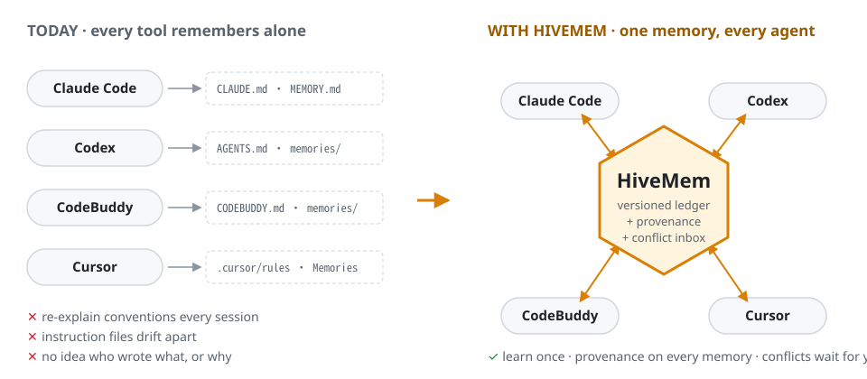
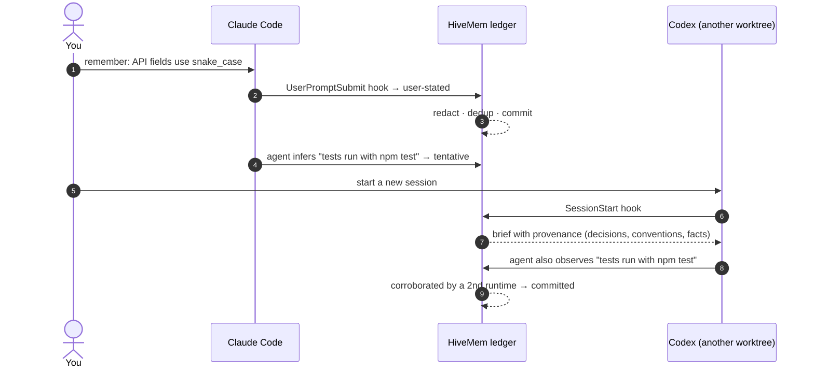
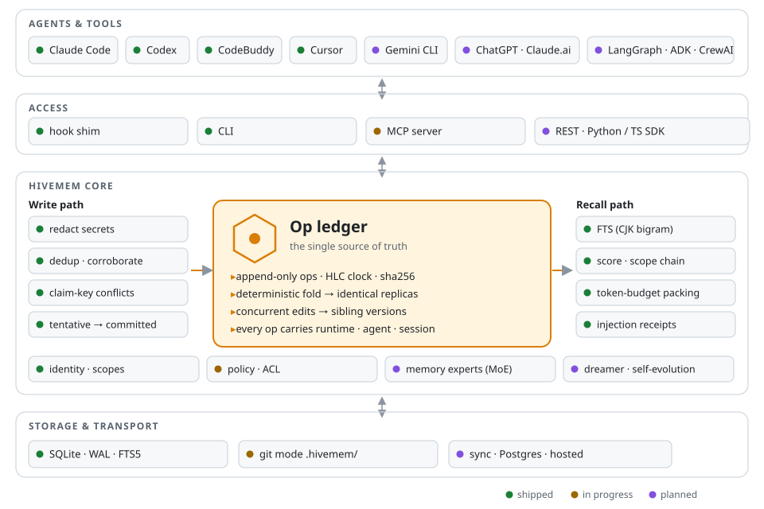

<!-- Keep the language bar in sync with docs/i18n/. Artwork is generated by `node scripts/gen-assets.mjs`. -->
<div align="center">

<picture>
  <source media="(prefers-color-scheme: dark)" srcset="docs/assets/logo-dark.svg">
  
</picture>

### One shared, versioned memory for every agent you use.

Claude Code · Codex · CodeBuddy · Cursor · Gemini CLI · multi-agent frameworks

<p>
  
  = 22.18" src="https://img.shields.io/badge/node-%E2%89%A5%2022.18-339933?logo=node.js&logoColor=white">
  
  
  
  
  
</p>

**English** · [简体中文](docs/i18n/README.zh-CN.md) · [日本語](docs/i18n/README.ja.md) · [한국어](docs/i18n/README.ko.md)

[Quick start](#-quick-start) · [How it works](#-how-it-works) · [Architecture](#%EF%B8%8F-architecture) · [Compare](#%EF%B8%8F-how-hivemem-compares) · [Roadmap](#%EF%B8%8F-roadmap) · [Design docs](docs/DESIGN.md)

</div>

<br>

<picture>
  <source media="(prefers-color-scheme: dark)" srcset="docs/assets/hero-dark.svg">
  
</picture>

You switch between agent tools all day: Claude Code for one task, Codex when you hit a rate limit, CodeBuddy or Cursor in the IDE. **Each one keeps its own memory**, so a convention you settle in one tool is unknown to the next. HiveMem gives all of them **one shared memory store**:

- **Learn once, use everywhere.** Hooks inject the relevant memories when a session starts and on every prompt, so the agent never has to "remember to remember".
- **Every memory has a source.** Each one records the tool, agent, session and model that wrote it, and the evidence behind it.
- **Disagreements aren't silently overwritten.** Concurrent edits become sibling versions. Contradictions go to an inbox for you to decide.
- **The core never calls an LLM.** It is local-first, uses one SQLite file, and adds nothing to your token bill.

> [!NOTE]
> **Status: v0.1 in development.** The ledger core, local store, recall, CLI and hook shims work and are tested (locally on Windows; CI covers macOS and Linux). The MCP server, git mode and the native-memory bridge are being built next ([roadmap](#%EF%B8%8F-roadmap)). Star the repo to follow along; interfaces may still change.

## 🎬 See it



## 🧭 Choose your starting point

| I want to… | Go to |
|---|---|
| See it work in 60 seconds | [Quick start](#-quick-start) |
| Share memory between Claude Code, Codex and CodeBuddy | [Connect your tools](#3-connect-your-tools) |
| Understand how conflicts, trust and versions work | [How it works](#-how-it-works) |
| Read the full design | [docs/DESIGN.md](docs/DESIGN.md) · [docs/ARCHITECTURE.md](docs/ARCHITECTURE.md) (in Chinese) |
| See the research behind it (20+ systems, 10+ papers) | [docs/research-landscape.md](docs/research-landscape.md) |
| Contribute | [CONTRIBUTING.md](CONTRIBUTING.md) |

## 😩 Why HiveMem

These are the most-discussed memory complaints in agent-tool issue trackers, and what HiveMem does about each one:

| Pain | Evidence | HiveMem |
|---|---|---|
| Every tool has its own instruction file and none read the others' | [claude-code#6235](https://github.com/anthropics/claude-code/issues/6235) (~460 comments), [codex#17401](https://github.com/openai/codex/issues/17401) | One ledger; instruction files become generated views *(v0.1, in progress)* |
| Context and conventions are lost after compaction | [claude-code#6354](https://github.com/anthropics/claude-code/issues/6354), [codex#2927](https://github.com/openai/codex/issues/2927) | Memories are re-injected on each prompt. Pre-compaction rescue comes in v0.1 |
| Auto-memory is opaque: you can't see what loaded or fix wrong facts | [claude-code#82056](https://github.com/anthropics/claude-code/issues/82056), [codex#30299](https://github.com/openai/codex/issues/30299) | Tentative → committed lifecycle, `inbox`, `show` with full history, injection receipts |
| Concurrent saves lose or duplicate memories | [codex#26684](https://github.com/openai/codex/issues/26684) | Deterministic merge; concurrent edits become sibling versions, never lost |
| Worktrees and machines split a project's memory | [claude-code#81833](https://github.com/anthropics/claude-code/issues/81833), [claude-code#81391](https://github.com/anthropics/claude-code/issues/81391) | Project identity from the normalised git remote, so every clone and worktree is one project |
| Switching tools at a rate limit means re-explaining everything | [claude-code#13354](https://github.com/anthropics/claude-code/issues/13354) | The next tool's session starts with the shared brief. Handoff batons come in v0.2 |

## 🚀 Quick start

### 1. Install

Requires **Node.js ≥ 22.18**. HiveMem has no runtime dependencies and uses Node's built-in SQLite, so there is nothing to compile.

```bash
git clone https://github.com/xi029/HiveMem.git hivemem && cd hivemem
npm install          # dev tooling only (TypeScript)
npm run check        # types, tests, build, offline package installation and CLI checks
```

> [!TIP]
> Once published, this becomes `npx hivemem setup`. Until then, replace `hivemem` with `node src/cli/main.ts` in the commands below.

### 2. Try it in 60 seconds

```bash
# You state a convention: committed immediately
hivemem remember "API fields use snake_case; the client converts at the API layer" --as user

# One agent infers a fact: tentative until another tool agrees
hivemem remember "Tests run with npm test" --key project:test.command --as agent --runtime claude-code
hivemem remember "Tests run with npm test" --key project:test.command --as agent --runtime codex
# → corroborated … (committed)

# Two agents disagree with equal authority: both go to your inbox
hivemem remember "Use pnpm" --key project:pkg.manager --as agent --runtime claude-code
hivemem remember "Use npm"  --key project:pkg.manager --as agent --runtime codex
hivemem inbox

# What a new session in this repo would be told, with provenance
hivemem brief
hivemem recall "how should I name fields in the new endpoint?"
```

### 3. Connect your tools

`hivemem setup` prints the hook configuration for each tool. Merge it into the file shown. One `hivemem hook` command serves every tool.

<details>
<summary><b>Claude Code</b>: <code>~/.claude/settings.json</code></summary>

```jsonc
{
  "hooks": {
    "SessionStart":     [{ "hooks": [{ "type": "command", "command": "hivemem hook SessionStart --runtime claude-code" }] }],
    "UserPromptSubmit": [{ "hooks": [{ "type": "command", "command": "hivemem hook UserPromptSubmit --runtime claude-code" }] }]
    // plus SubagentStart, Stop, PreCompact, SessionEnd: see `hivemem setup --target claude-code`
  }
}
```
</details>

<details>
<summary><b>CodeBuddy Code</b>: <code>~/.codebuddy/settings.json</code></summary>

CodeBuddy Code uses the same hook schema as Claude Code. Run `hivemem setup --target codebuddy` and merge the output.
</details>

<details>
<summary><b>Codex CLI</b>: <code>~/.codex/hooks.json</code></summary>

Codex hooks follow a near-identical schema (the field-by-field mapping is still being verified against recorded payloads). Run `hivemem setup --target codex`, then trust the hooks with `/hooks`.
</details>

<details>
<summary><b>Cursor</b>: <code>.cursor/hooks.json</code></summary>

Use `--runtime cursor`. HiveMem replies in Cursor's `additional_context` format.
</details>

<details>
<summary><b>Anything else</b>: MCP <i>(coming in v0.1)</i></summary>

An MCP server (stdio and Streamable HTTP) will cover Gemini CLI, Copilot, Windsurf, Zed, ChatGPT, Claude.ai and agent frameworks.
</details>

**Tell it things directly.** In any connected tool, start a prompt with `remember that …` (or `记住：…`, `覚えて：…`, `기억해: …`) and it's stored as *your* statement.

## 🧠 How it works



**Write ≠ belief.** Every memory moves through a small lifecycle. Only *committed* memories are shown to other agents by default:

```mermaid
stateDiagram-v2
    direction LR
    [*] --> tentative: an agent writes
    tentative --> committed: another tool agrees / you confirm
    [*] --> committed: you state it
    tentative --> quarantined: same-authority conflict
    quarantined --> committed: you decide
    committed --> conflicted: concurrent edits
    conflicted --> tentative: resolve; review the merged version
    committed --> tentative: revise
    committed --> superseded: newer statement wins
    committed --> archived: archive
    committed --> revoked: forget
```



**Who wins a contradiction?** Memories can carry a *claim key*, such as `project:test.command`. Two different answers under the same key are a conflict that HiveMem detects without an LLM:

| New statement vs existing | Outcome |
|---|---|
| You vs an agent | Yours wins; the old one is **superseded** (history kept) |
| You vs your own earlier statement | You changed your mind; the newer one wins |
| Agent vs you | Agent's stays **tentative** and is linked as `contradicts` |
| Agent vs agent | Both are **quarantined** and wait in `hivemem inbox` |

**Review conflicts.** Run `hivemem show <id>`, then `hivemem confirm <id>` to select the correct claim and supersede its conflicting alternatives. For sibling versions, use `resolve` first. Both `revise` and `resolve` create tentative versions that need fresh confirmation. Conflicted, quarantined, untrusted and claim-blocked content is excluded from recall. Two runtime names agreeing is a heuristic, not proof of independent evidence. See [trust, upgrades and recovery](docs/trust-and-recovery.md).

**Recall** ranks candidates by relevance, importance with decay, recency, confidence (corroboration raises it) and scope proximity. The estimated token budget includes the complete rendered context. Unchanged versions are deduplicated within a session; revisions and confirmations can be injected again, and session restarts reset receipts. Chinese, Japanese and Korean text is indexed as character bigrams, so a two-character query like `字段` matches no matter how the sentence is segmented.

## 🏗️ Architecture

<picture>
  <source media="(prefers-color-scheme: dark)" srcset="docs/assets/architecture-dark.svg">
  
</picture>

Design choices that set HiveMem apart:

- **Memory is a ledger, not a vector store.** Every change is an immutable op with a hybrid logical clock and a content hash. Tables, search indexes and (soon) instruction files are projections rebuilt from the ledger.
- **A real consistency model.** Replicas that hold the same ops compute byte-identical state, whatever order the ops arrived in. Concurrent edits are kept as siblings, so no write is lost. Property tests check this over random partial syncs with skewed clocks.
- **Stable project identity.** The project ID comes from the normalised git remote (falling back to the root commit, then the path). HiveMem reads `.git/config` directly, so every clone and worktree is one project and no `git` subprocess runs.
- **Built for teams and hosting.** Every op carries tenant, principal, runtime, agent and session. Scopes form a chain: session → agent → you-in-project → project → you.

Deep dive: [ARCHITECTURE.md](docs/ARCHITECTURE.md) covers the data model, ledger, consistency, write and recall pipelines, git mode, sync, security and memory experts (MoE).

## ⚖️ How HiveMem compares

|  | **HiveMem** | mem0 | Supermemory | Letta | Mnemon |
|---|:-:|:-:|:-:|:-:|:-:|
| Fully open-source engine | ✅ | ✅ | ◐ ¹ | ✅ | ✅ |
| Plugs into many coding tools via hooks | ✅ | ◐ | ✅ | ◐ ² | ✅ |
| Versioned history; concurrent edits never lost | ✅ | — | ◐ | ◐ ³ | — |
| Per-memory provenance (tool · agent · session) | ✅ | ◐ | ◐ | ◐ | ◐ |
| Conflict inbox: agents can't silently overwrite each other | ✅ | — | — | — | — |
| Core runs without any LLM | ✅ | — | — | — | ✅ |
| Managed cloud | planned | ✅ | ✅ | ✅ | — |
| Published benchmark results | planned | ✅ | ✅ | ✅ | — |

<sub>✅ yes · ◐ partial · — not a focus. Based on public docs as of Oct 2026; corrections welcome. ¹ The memory engine itself is not in the public repo. ² Memory lives inside Letta's own agent runtime. ³ Git-backed memory files (MemFS). Each project has strengths HiveMem doesn't, so read their docs too.</sub>

## 🧰 CLI

| Command | What it does |
|---|---|
| `hivemem remember <text>` | Store a memory: `--kind fact\|decision\|event\|procedure`, `--key subject:aspect`, `--as user\|agent`, `--scope project\|user\|agent`, `--tags`, `--importance` |
| `hivemem recall <query>` | Ranked, budgeted context with provenance (`--json` includes per-signal scores) |
| `hivemem brief` | What a new session in this repo gets injected |
| `hivemem inbox` | Tentative, conflicted and quarantined memories |
| `hivemem show <id>` | Full history: versions, ops, corroborations, warnings |
| `hivemem confirm \| forget \| archive <id>` | Move a memory through its lifecycle |
| `hivemem revise <id> <text>` / `resolve <id>` | Edit, or settle a conflict with `--choose` or `--content` |
| `hivemem pin \| unpin <id>` | Always keep a memory in context |
| `hivemem log` · `stats` · `project` | Op log, counts, current project identity |
| `hivemem rebuild` | Rebuild memory projections, claim conflicts and search indexes from the unchanged ledger |
| `hivemem hook <event> --runtime <tool>` | Entry point for tool hooks (reads JSON on stdin; never blocks the host) |
| `hivemem setup [--target …]` | Print hook config for Claude Code, Codex and CodeBuddy |

IDs can be shortened to their last 6 characters. Data lives in `~/.hivemem/` (override with `HIVEMEM_HOME`).

## 🗺️ Roadmap

- **v0.1 Cross-tool sharing** *(in progress)*
  - [x] Op ledger: HLC, hashing, deterministic fold, sibling versions, convergence tests
  - [x] SQLite store; CJK-aware full-text search
  - [x] Write path: redaction, dedup, corroboration, claim-key conflicts
  - [x] Recall: scoring, scope chain, token budget, per-session dedupe
  - [x] CLI and hook shims (Claude Code · Codex · CodeBuddy · Cursor)
  - [ ] MCP server (stdio + Streamable HTTP)
  - [ ] Git mode: `.hivemem/memories/*.md`, where pull-request review is memory review
  - [ ] Native memory bridge: `MEMORY.md`, Codex and CodeBuddy memories; managed blocks in `CLAUDE.md` / `AGENTS.md` / `CODEBUDDY.md`
  - [ ] `setup --apply / --eject`, pre-compaction rescue, web console (timeline · inbox · injection receipts)
  - [ ] npm release
- **v0.2 Multi-agent collaboration**: handoff batons, file/task claims, change feed, subagent memory, memory experts with rule-based routing, embeddings
- **v0.3 Teams and office agents**: `hivemem serve` (Postgres, OAuth, remote MCP), multi-device sync, ChatGPT / Claude.ai / Copilot Studio, Feishu and Slack bots
- **v0.4 Self-evolution**: background consolidation, skill distillation exported as `SKILL.md`, learned routing, a "who knows what" expertise map
- **v0.5 Ecosystem**: Python/TS SDKs, LangGraph · ADK · Agent Framework · CrewAI adapters, A2A, an open multi-agent memory benchmark

## ❓ FAQ

<details>
<summary><b>Does HiveMem send my code or memories anywhere?</b></summary>

No. Everything is stored in one SQLite file under `~/.hivemem/`. The core makes no network calls and no LLM calls. Secrets such as API keys, tokens, private keys and connection strings are redacted before anything is written.
</details>

<details>
<summary><b>Does it replace CLAUDE.md / AGENTS.md or the tools' own memory?</b></summary>

No. HiveMem bridges them rather than replacing them. The planned native bridge imports each tool's memory files and writes managed blocks back, leaving the rest of each file untouched. If you uninstall HiveMem, every tool keeps working with its own files.
</details>

<details>
<summary><b>How is this different from syncing rule files (ruler, rulesync)?</b></summary>

Those copy *static* rules between formats. HiveMem syncs *learned* memory, and each memory has a status, provenance, versions and conflict handling. The rule files are one view rendered from it.
</details>

<details>
<summary><b>Will it slow my agent down?</b></summary>

A hook call takes about 116 ms on Windows. Most of that is Node's own startup (about 71 ms); HiveMem's work is about 45 ms. A resident daemon is planned to cut this further.
</details>

<details>
<summary><b>What happens when two agents disagree?</b></summary>

If one of the statements is yours, yours wins. If both come from agents with equal authority, both are quarantined and shown in `hivemem inbox`, and new sessions get a note that something needs review. Nothing is deleted. Every version stays in `hivemem show`.
</details>

## 🤝 Contributing

Issues and PRs are welcome. Good first areas:

- hook adapters for more tools;
- memory experts;
- translations;
- the benchmark.

See [CONTRIBUTING.md](CONTRIBUTING.md). The design is documented in [DESIGN.md](docs/DESIGN.md) and [ARCHITECTURE.md](docs/ARCHITECTURE.md).

## 🙏 Acknowledgements

HiveMem builds on ideas from:

- [A-MEM](https://github.com/agiresearch/A-mem): evolving linked notes.
- [Mnemon](https://github.com/mnemon-dev/mnemon): an LLM-free core and broad hook coverage.
- [Supermemory](https://github.com/supermemoryai/supermemory): update/extend/derive relations.
- [Letta](https://github.com/letta-ai/letta): git-backed memory.
- [Graphiti](https://github.com/getzep/graphiti): bi-temporal facts.
- [mem0](https://github.com/mem0ai/mem0): scoped memory.
- Research papers:
  - [MemTX](https://www.alphaxiv.org/abs/2607.23929): write ≠ belief.
  - [Collaborative Memory](https://arxiv.org/abs/2505.18279): provenance and access control.
  - [ShardMemo](https://arxiv.org/abs/2601.21545): masked expert routing.
  - [ACE](https://arxiv.org/abs/2510.04618) and [ReasoningBank](https://arxiv.org/abs/2509.25140): self-evolving procedures.

## 📄 License

[Apache-2.0](LICENSE). If you use HiveMem in research, please cite:

```bibtex
@software{hivemem2026,
  title  = {HiveMem: Shared, Versioned Memory for Multi-Agent and Cross-Tool Collaboration},
  year   = {2026},
  note   = {Version 0.1-dev}
}
```

<div align="center"><sub>Made for people who use more than one agent. 🐝</sub></div>
