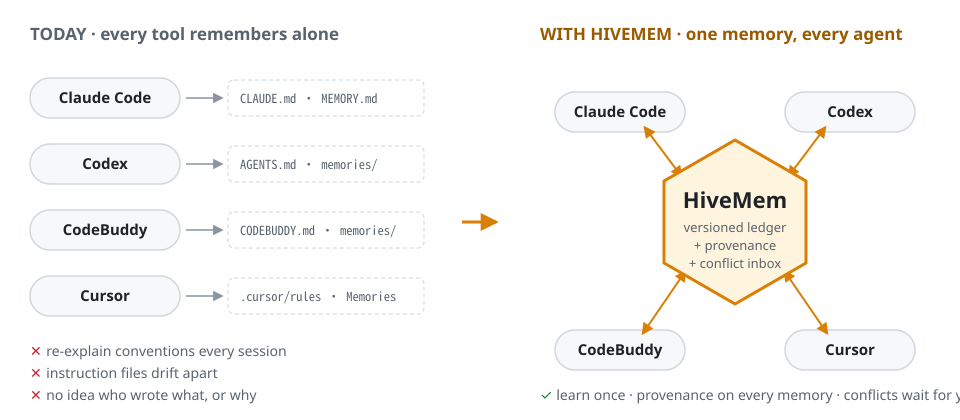
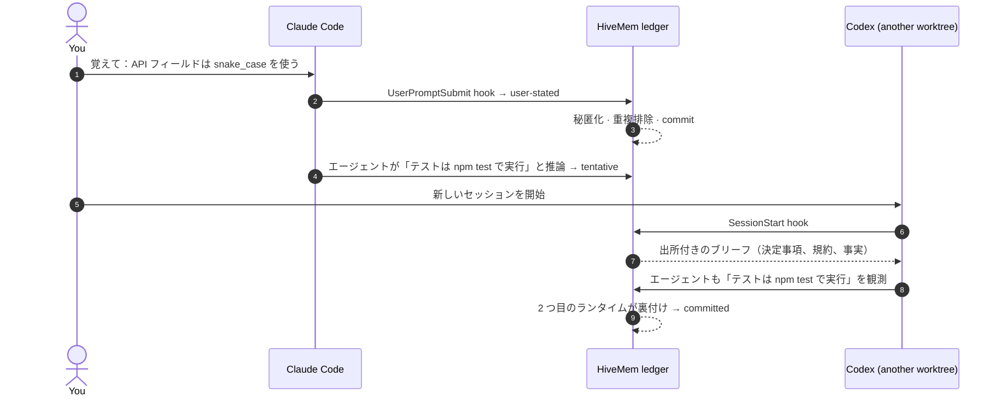
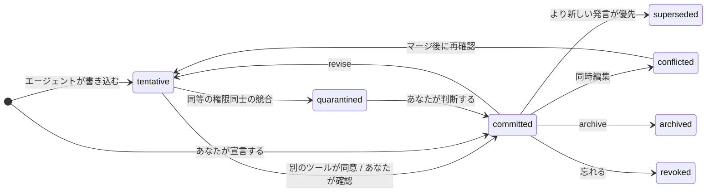
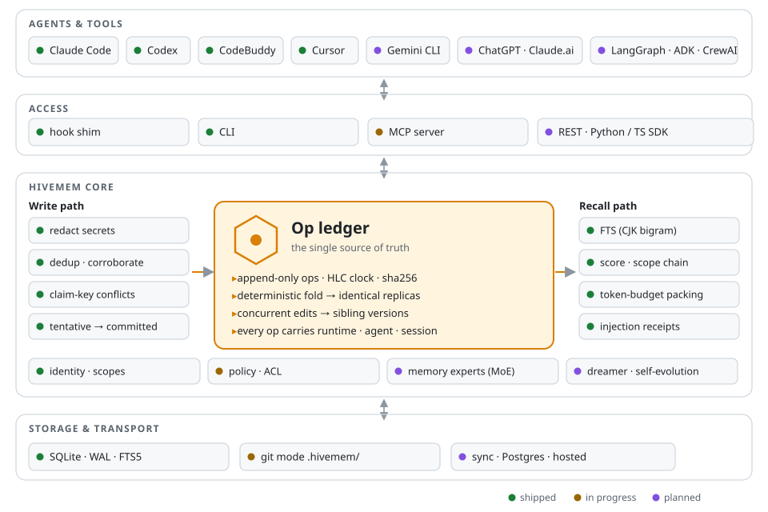

<!-- Translated from README.md; keep in sync. -->
<div align="center">

<picture>
  <source media="(prefers-color-scheme: dark)" srcset="../assets/logo-dark.svg">
  
</picture>

### 使っているすべてのエージェントに、バージョン管理された共有メモリをひとつ。

Claude Code · Codex · CodeBuddy · Cursor · Gemini CLI · マルチエージェントフレームワーク

<p>
  
  = 22.18" src="https://img.shields.io/badge/node-%E2%89%A5%2022.18-339933?logo=node.js&logoColor=white">
  
  
  
  
  
</p>

[English](../../README.md) · [简体中文](README.zh-CN.md) · **日本語** · [한국어](README.ko.md)

[クイックスタート](#-クイックスタート) · [仕組み](#-仕組み) · [アーキテクチャ](#%EF%B8%8F-アーキテクチャ) · [比較](#%EF%B8%8F-他プロジェクトとの比較) · [ロードマップ](#%EF%B8%8F-ロードマップ) · [設計ドキュメント](../DESIGN.md)

</div>

<br>

<picture>
  <source media="(prefers-color-scheme: dark)" srcset="../assets/hero-dark.svg">
  
</picture>

あなたは一日中、複数のエージェントツールを行き来しています。あるタスクには Claude Code、レート制限に達したら Codex、IDE では CodeBuddy や Cursor。**それぞれが独自のメモリを持っている**ため、あるツールで決めた規約を次のツールは知りません。HiveMem は、そのすべてに **1 つの共有メモリストア**を提供します。

- **一度覚えれば、どこでも使える。** セッション開始時とプロンプトごとに hook が関連するメモリを注入するので、エージェントが「覚えておくことを覚えておく」必要はありません。
- **すべてのメモリに出所がある。** 各メモリには、それを書いたツール、エージェント、セッション、モデルと、その根拠となるエビデンスが記録されます。
- **意見の食い違いが黙って上書きされない。** 同時編集は兄弟バージョン（sibling version）になります。矛盾は inbox に送られ、あなたが判断します。
- **コアは LLM を一切呼び出さない。** ローカルファーストで SQLite ファイル 1 つだけを使い、トークン代は一切増えません。

> [!NOTE]
> **ステータス：v0.1 開発中。** ledger コア、ローカルストア、recall、CLI、hook シムは動作し、テスト済みです（ローカルでは Windows、CI では macOS と Linux）。MCP サーバー、git モード、ネイティブメモリブリッジは次に構築します（[ロードマップ](#%EF%B8%8F-ロードマップ)）。進捗を追うにはリポジトリにスターを付けてください。インターフェースはまだ変わる可能性があります。

## 🎬 デモ



## 🧭 どこから始めるか

| やりたいこと | 参照先 |
|---|---|
| 60 秒で動作を見たい | [クイックスタート](#-クイックスタート) |
| Claude Code、Codex、CodeBuddy の間でメモリを共有したい | [ツールを接続する](#3-ツールを接続する) |
| 競合、信頼、バージョンの仕組みを理解したい | [仕組み](#-仕組み) |
| 設計の全体を読みたい | [docs/DESIGN.md](../DESIGN.md) · [docs/ARCHITECTURE.md](../ARCHITECTURE.md)（中国語） |
| 背景にある調査を見たい（20 以上のシステム、10 本以上の論文） | [docs/research-landscape.md](../research-landscape.md) |
| コントリビュートしたい | [CONTRIBUTING.md](../../CONTRIBUTING.md) |

## 😩 HiveMem が必要な理由

以下は、エージェントツールの issue トラッカーで最も多く議論されているメモリに関する不満と、それぞれに対する HiveMem の対応です。

| 課題 | 根拠 | HiveMem |
|---|---|---|
| ツールごとに独自の指示ファイルがあり、どれも他のツールのファイルを読まない | [claude-code#6235](https://github.com/anthropics/claude-code/issues/6235)（コメント約 460 件）、[codex#17401](https://github.com/openai/codex/issues/17401) | ledger は 1 つ。指示ファイルはそこから生成されるビューになる *（v0.1、開発中）* |
| compaction の後にコンテキストや規約が失われる | [claude-code#6354](https://github.com/anthropics/claude-code/issues/6354)、[codex#2927](https://github.com/openai/codex/issues/2927) | メモリはプロンプトごとに再注入される。compaction 前の退避は v0.1 で提供予定 |
| 自動メモリが不透明で、何が読み込まれたか見えず、誤った事実も直せない | [claude-code#82056](https://github.com/anthropics/claude-code/issues/82056)、[codex#30299](https://github.com/openai/codex/issues/30299) | tentative → committed のライフサイクル、`inbox`、完全な履歴を表示する `show`、注入レシート（injection receipt） |
| 同時保存でメモリが失われたり重複したりする | [codex#26684](https://github.com/openai/codex/issues/26684) | 決定的なマージ。同時編集は兄弟バージョンになり、失われることはない |
| worktree やマシンごとにプロジェクトのメモリが分断される | [claude-code#81833](https://github.com/anthropics/claude-code/issues/81833)、[claude-code#81391](https://github.com/anthropics/claude-code/issues/81391) | 正規化した git remote からプロジェクト ID を決めるため、すべての clone と worktree が 1 つのプロジェクトになる |
| レート制限でツールを切り替えると、すべてを説明し直すことになる | [claude-code#13354](https://github.com/anthropics/claude-code/issues/13354) | 次のツールのセッションは共有ブリーフから始まる。引き継ぎバトン（handoff baton）は v0.2 で提供予定 |

## 🚀 クイックスタート

### 1. インストール

**Node.js ≥ 22.18** が必要です。HiveMem にはランタイム依存がなく、Node 組み込みの SQLite を使うため、コンパイルは一切不要です。

```bash
git clone https://github.com/xi029/HiveMem.git hivemem && cd hivemem
npm install          # 開発用ツールのみ（TypeScript）
npm run check        # 型検査・テスト・ビルド・オフラインインストール・CLI 検証
```

> [!TIP]
> 公開後は `npx hivemem setup` になります。それまでは、以下のコマンドの `hivemem` を `node src/cli/main.ts` に置き換えてください。

### 2. 60 秒で試す

```bash
# あなたが規約を宣言する：即座に committed
hivemem remember "API fields use snake_case; the client converts at the API layer" --as user

# 1 つのエージェントが事実を推論する：別のツールが同意するまで tentative
hivemem remember "Tests run with npm test" --key project:test.command --as agent --runtime claude-code
hivemem remember "Tests run with npm test" --key project:test.command --as agent --runtime codex
# → corroborated … (committed)

# 同等の権限を持つ 2 つのエージェントが食い違う：両方ともあなたの inbox へ
hivemem remember "Use pnpm" --key project:pkg.manager --as agent --runtime claude-code
hivemem remember "Use npm"  --key project:pkg.manager --as agent --runtime codex
hivemem inbox

# このリポジトリで新しいセッションが伝えられる内容（出所付き）
hivemem brief
hivemem recall "how should I name fields in the new endpoint?"
```

### 3. ツールを接続する

`hivemem setup` は各ツール向けの hook 設定を出力します。表示されたファイルにマージしてください。1 つの `hivemem hook` コマンドがすべてのツールに対応します。

<details>
<summary><b>Claude Code</b>: <code>~/.claude/settings.json</code></summary>

```jsonc
{
  "hooks": {
    "SessionStart":     [{ "hooks": [{ "type": "command", "command": "hivemem hook SessionStart --runtime claude-code" }] }],
    "UserPromptSubmit": [{ "hooks": [{ "type": "command", "command": "hivemem hook UserPromptSubmit --runtime claude-code" }] }]
    // ほかに SubagentStart、Stop、PreCompact、SessionEnd もある：`hivemem setup --target claude-code` を参照
  }
}
```
</details>

<details>
<summary><b>CodeBuddy Code</b>: <code>~/.codebuddy/settings.json</code></summary>

CodeBuddy Code は Claude Code と同じ hook スキーマを使います。`hivemem setup --target codebuddy` を実行し、出力をマージしてください。
</details>

<details>
<summary><b>Codex CLI</b>: <code>~/.codex/hooks.json</code></summary>

Codex の hook はほぼ同一のスキーマに従います（フィールドごとの対応は、記録したペイロードとの照合をまだ進めているところです）。`hivemem setup --target codex` を実行し、`/hooks` で hook を信頼してください。
</details>

<details>
<summary><b>Cursor</b>: <code>.cursor/hooks.json</code></summary>

`--runtime cursor` を使います。HiveMem は Cursor の `additional_context` 形式で応答します。
</details>

<details>
<summary><b>その他すべて</b>: MCP <i>（v0.1 で提供予定）</i></summary>

MCP サーバー（stdio と Streamable HTTP）で、Gemini CLI、Copilot、Windsurf、Zed、ChatGPT、Claude.ai、エージェントフレームワークに対応する予定です。
</details>

**直接伝える。** 接続済みのどのツールでも、プロンプトを `覚えて：…`（または `覚えておいて：…`、`remember that …`、`记住：…`、`기억해: …`）で始めると、*あなた自身*の発言として保存されます。

## 🧠 仕組み



**書き込み ≠ 信念。** すべてのメモリは小さなライフサイクルをたどります。デフォルトで他のエージェントに表示されるのは *committed* のメモリだけです。



**矛盾したらどちらが勝つ？** メモリには `project:test.command` のような *claim key*（主張キー）を付けられます。同じキーの下に異なる 2 つの答えがあればそれは競合であり、HiveMem は LLM を使わずにそれを検出します。

| 新しい発言 vs 既存の発言 | 結果 |
|---|---|
| あなた vs エージェント | あなたの発言が勝ち、古いほうは **superseded** になる（履歴は保持） |
| あなた vs あなた自身の以前の発言 | 考えが変わったとみなし、新しいほうが勝つ |
| エージェント vs あなた | エージェントの発言は **tentative** のままとなり、`contradicts` としてリンクされる |
| エージェント vs エージェント | 両方とも **quarantined** になり、`hivemem inbox` で待機する |

**競合のレビュー。** `show <id>` で確認し、`confirm <id>` で正しい主張を選択します。同じキーの異なる主張は履歴に残して置き換えられます。兄弟バージョンは先に `resolve` でマージしてください。`revise` と `resolve` の新しい内容は再確認が必要です。競合中・隔離中・未信頼・同一キーの競合で保留中の内容は recall に入りません。異なるランタイムの同意は独立した証拠の証明ではありません。[アップグレードと復旧](../trust-and-recovery.md)も参照してください。

**Recall（想起）** は、関連度、減衰を考慮した重要度、新しさ、確信度（裏付けがあると上がる）、スコープの近さで候補をランク付けします。そのうえでトークン予算内に詰め込み、同一セッションでは変更のないバージョンを重複注入しません。修正・確認後は再注入でき、セッション再開時にはレシートをリセットします。中国語、日本語、韓国語のテキストは文字バイグラムとしてインデックスされるため、`字段` のような 2 文字のクエリも、文がどう分かち書きされていてもマッチします。

## 🏗️ アーキテクチャ

<picture>
  <source media="(prefers-color-scheme: dark)" srcset="../assets/architecture-dark.svg">
  
</picture>

HiveMem を特徴づける設計上の選択：

- **メモリはベクトルストアではなく ledger。** すべての変更は、ハイブリッド論理クロックとコンテンツハッシュを持つ不変の op です。テーブル、検索インデックス、そして（近日中に）指示ファイルは、ledger から再構築される射影（projection）です。
- **本物の一貫性モデル。** 同じ op を持つレプリカは、op がどの順序で届いても、バイト単位で同一の状態を計算します。同時編集は兄弟として保持されるため、書き込みが失われることはありません。プロパティテストで、時計のずれたランダムな部分同期に対してこれを検証しています。
- **安定したプロジェクト ID。** プロジェクト ID は正規化した git remote から決まります（取得できなければ root commit、次にパスにフォールバック）。HiveMem は `.git/config` を直接読むため、すべての clone と worktree が 1 つのプロジェクトになり、`git` サブプロセスは一切起動しません。
- **チームとホスティングを前提に設計。** すべての op は tenant、principal、runtime、agent、session を持ちます。スコープはチェーンを形成します：セッション → エージェント → プロジェクト内のあなた → プロジェクト → あなた。

詳細：[ARCHITECTURE.md](../ARCHITECTURE.md) では、データモデル、ledger、一貫性、書き込みと recall のパイプライン、git モード、同期、セキュリティ、メモリエキスパート（MoE）を解説しています。

## ⚖️ 他プロジェクトとの比較

|  | **HiveMem** | mem0 | Supermemory | Letta | Mnemon |
|---|:-:|:-:|:-:|:-:|:-:|
| エンジンが完全にオープンソース | ✅ | ✅ | ◐ ¹ | ✅ | ✅ |
| hook で多数のコーディングツールに接続できる | ✅ | ◐ | ✅ | ◐ ² | ✅ |
| バージョン履歴あり、同時編集が失われない | ✅ | — | ◐ | ◐ ³ | — |
| メモリごとの出所（ツール · エージェント · セッション） | ✅ | ◐ | ◐ | ◐ | ◐ |
| 競合 inbox：エージェント同士が黙って上書きできない | ✅ | — | — | — | — |
| コアが LLM なしで動作する | ✅ | — | — | — | ✅ |
| マネージドクラウド | 予定 | ✅ | ✅ | ✅ | — |
| ベンチマーク結果の公開 | 予定 | ✅ | ✅ | ✅ | — |

<sub>✅ あり · ◐ 一部 · — 注力対象外。2026 年 10 月時点の公開ドキュメントに基づきます。訂正を歓迎します。¹ メモリエンジン自体は公開リポジトリに含まれていません。² メモリは Letta 独自のエージェントランタイムの中にあります。³ Git で管理されるメモリファイル（MemFS）。どのプロジェクトにも HiveMem にはない強みがあるので、それぞれのドキュメントもぜひ読んでください。</sub>

## 🧰 CLI

| コマンド | 内容 |
|---|---|
| `hivemem remember <text>` | メモリを保存する：`--kind fact\|decision\|event\|procedure`、`--key subject:aspect`、`--as user\|agent`、`--scope project\|user\|agent`、`--tags`、`--importance` |
| `hivemem recall <query>` | ランク付けされ予算内に収めた、出所付きのコンテキスト（`--json` でシグナルごとのスコアも含む） |
| `hivemem brief` | このリポジトリの新しいセッションに注入される内容 |
| `hivemem inbox` | tentative、conflicted、quarantined のメモリ |
| `hivemem show <id>` | 完全な履歴：バージョン、op、裏付け、警告 |
| `hivemem confirm \| forget \| archive <id>` | メモリをライフサイクルに沿って進める |
| `hivemem revise <id> <text>` / `resolve <id>` | 編集する、または `--choose` か `--content` で競合を解決する |
| `hivemem pin \| unpin <id>` | メモリを常にコンテキストに含める |
| `hivemem log` · `stats` · `project` | op ログ、件数、現在のプロジェクト ID |
| `hivemem rebuild` | 保持した ledger からメモリ・競合・検索インデックスを再構築 |
| `hivemem hook <event> --runtime <tool>` | ツールの hook のエントリポイント（stdin から JSON を読む。ホストをブロックしない） |
| `hivemem setup [--target …]` | Claude Code、Codex、CodeBuddy 向けの hook 設定を出力する |

ID は末尾 6 文字に短縮できます。データは `~/.hivemem/` に保存されます（`HIVEMEM_HOME` で変更可能）。

## 🗺️ ロードマップ

- **v0.1 ツール間共有** *（開発中）*
  - [x] Op ledger：HLC、ハッシュ、決定的な fold、兄弟バージョン、収束テスト
  - [x] SQLite ストア、CJK 対応の全文検索
  - [x] 書き込みパス：秘匿化、重複排除、裏付け、claim key の競合
  - [x] Recall：スコアリング、スコープチェーン、トークン予算、セッションごとの重複排除
  - [x] CLI と hook シム（Claude Code · Codex · CodeBuddy · Cursor）
  - [ ] MCP サーバー（stdio + Streamable HTTP）
  - [ ] Git モード：`.hivemem/memories/*.md`。プルリクエストのレビューがそのままメモリのレビューになる
  - [ ] ネイティブメモリブリッジ：`MEMORY.md`、Codex と CodeBuddy のメモリ、`CLAUDE.md` / `AGENTS.md` / `CODEBUDDY.md` 内の管理ブロック
  - [ ] `setup --apply / --eject`、compaction 前の退避、Web コンソール（タイムライン · inbox · 注入レシート）
  - [ ] npm リリース
- **v0.2 マルチエージェント協調**：引き継ぎバトン、ファイル/タスクのクレーム、変更フィード、サブエージェントのメモリ、ルールベースのルーティングを備えたメモリエキスパート、埋め込み
- **v0.3 チームとオフィスエージェント**：`hivemem serve`（Postgres、OAuth、リモート MCP）、複数デバイス間の同期、ChatGPT / Claude.ai / Copilot Studio、Feishu と Slack のボット
- **v0.4 自己進化**：バックグラウンドでの統合、`SKILL.md` としてエクスポートされるスキル蒸留、学習によるルーティング、「誰が何を知っているか」の専門性マップ
- **v0.5 エコシステム**：Python/TS SDK、LangGraph · ADK · Agent Framework · CrewAI アダプター、A2A、オープンなマルチエージェントメモリベンチマーク

## ❓ よくある質問

<details>
<summary><b>HiveMem はコードやメモリをどこかに送信しますか？</b></summary>

いいえ。すべては `~/.hivemem/` 配下の SQLite ファイル 1 つに保存されます。コアはネットワーク呼び出しも LLM 呼び出しも行いません。API キー、トークン、秘密鍵、接続文字列などのシークレットは、何かを書き込む前に秘匿化されます。
</details>

<details>
<summary><b>CLAUDE.md / AGENTS.md や各ツール独自のメモリを置き換えるものですか？</b></summary>

いいえ。HiveMem はそれらを置き換えるのではなく、橋渡しします。予定しているネイティブブリッジは、各ツールのメモリファイルを取り込み、管理ブロックを書き戻します。各ファイルのそれ以外の部分には手を触れません。HiveMem をアンインストールしても、各ツールはそれぞれのファイルでそのまま動作します。
</details>

<details>
<summary><b>ルールファイルの同期ツール（ruler、rulesync）とは何が違いますか？</b></summary>

それらは *静的な* ルールをフォーマット間でコピーするものです。HiveMem が同期するのは *学習された* メモリで、各メモリはステータス、出所、バージョン、競合処理を持ちます。ルールファイルは、そこからレンダリングされるビューの 1 つにすぎません。
</details>

<details>
<summary><b>エージェントが遅くなりませんか？</b></summary>

hook の呼び出しには Windows で約 116 ms かかります。その大半は Node 自体の起動（約 71 ms）で、HiveMem の処理は約 45 ms です。これをさらに短縮するため、常駐デーモンを予定しています。
</details>

<details>
<summary><b>2 つのエージェントの意見が食い違ったらどうなりますか？</b></summary>

一方があなたの発言なら、あなたの発言が勝ちます。どちらも同等の権限を持つエージェントによるものなら、両方とも quarantined になって `hivemem inbox` に表示され、新しいセッションにはレビューが必要な項目があるという注記が渡されます。何も削除されません。すべてのバージョンは `hivemem show` に残ります。
</details>

## 🤝 コントリビュート

Issue と PR を歓迎します。最初に取り組みやすい分野：

- より多くのツール向けの hook アダプター
- メモリエキスパート
- 翻訳
- ベンチマーク

[CONTRIBUTING.md](../../CONTRIBUTING.md) を参照してください。設計は [DESIGN.md](../DESIGN.md) と [ARCHITECTURE.md](../ARCHITECTURE.md) にまとめています。

## 🙏 謝辞

HiveMem は以下のアイデアを土台にしています。

- [A-MEM](https://github.com/agiresearch/A-mem)：進化するリンク付きノート。
- [Mnemon](https://github.com/mnemon-dev/mnemon)：LLM を使わないコアと幅広い hook 対応。
- [Supermemory](https://github.com/supermemoryai/supermemory)：update/extend/derive の関係。
- [Letta](https://github.com/letta-ai/letta)：Git で管理されるメモリ。
- [Graphiti](https://github.com/getzep/graphiti)：二時間軸（bi-temporal）の事実。
- [mem0](https://github.com/mem0ai/mem0)：スコープ付きメモリ。
- 研究論文：
  - [MemTX](https://www.alphaxiv.org/abs/2607.23929)：書き込み ≠ 信念。
  - [Collaborative Memory](https://arxiv.org/abs/2505.18279)：出所とアクセス制御。
  - [ShardMemo](https://arxiv.org/abs/2601.21545)：マスク付きエキスパートルーティング。
  - [ACE](https://arxiv.org/abs/2510.04618) と [ReasoningBank](https://arxiv.org/abs/2509.25140)：自己進化する手順。

## 📄 ライセンス

[Apache-2.0](../../LICENSE)。研究で HiveMem を使用する場合は、以下のように引用してください。

```bibtex
@software{hivemem2026,
  title  = {HiveMem: Shared, Versioned Memory for Multi-Agent and Cross-Tool Collaboration},
  year   = {2026},
  note   = {Version 0.1-dev}
}
```

<div align="center"><sub>複数のエージェントを使いこなすすべての人へ。🐝</sub></div>
