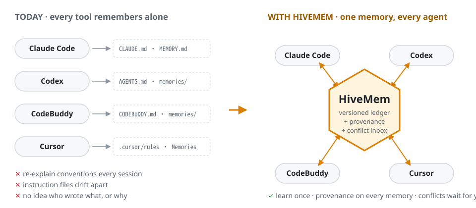
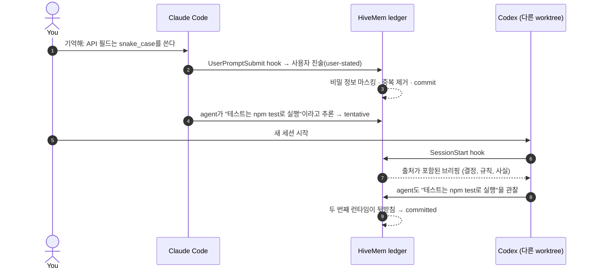
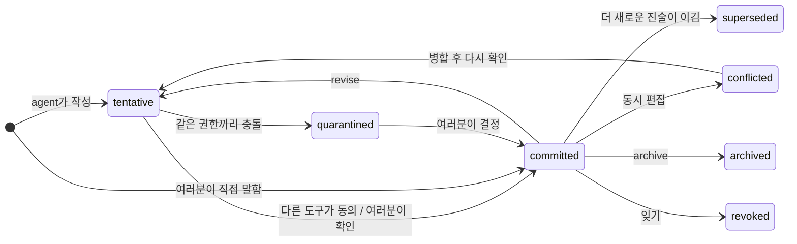
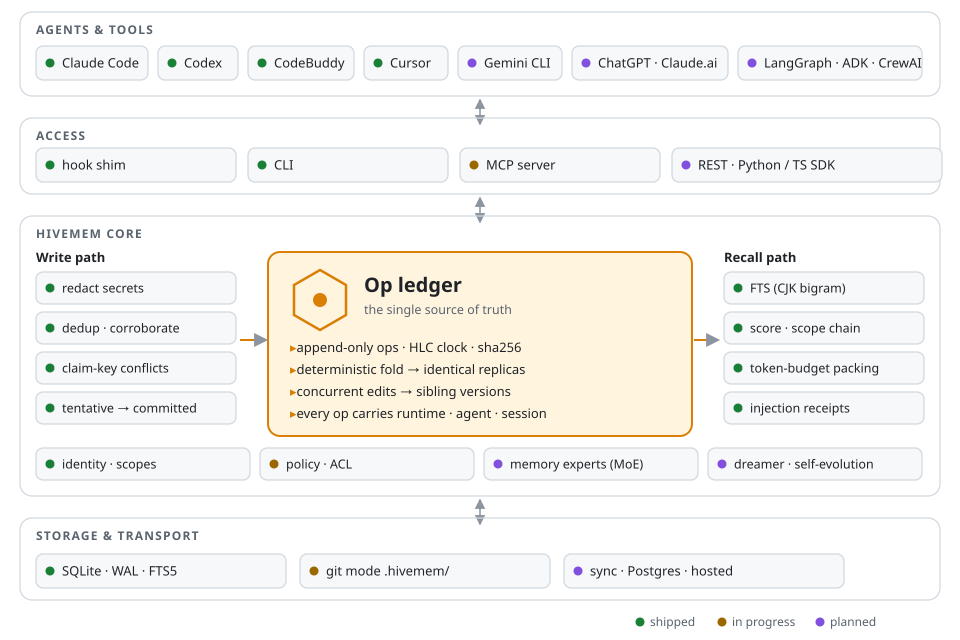

<!-- Translated from README.md; keep in sync. -->
<div align="center">

<picture>
  <source media="(prefers-color-scheme: dark)" srcset="../assets/logo-dark.svg">
  
</picture>

### 여러분이 쓰는 모든 agent를 위한, 버전 관리되는 하나의 공유 메모리.

Claude Code · Codex · CodeBuddy · Cursor · Gemini CLI · 멀티 agent 프레임워크

<p>
  
  = 22.18" src="https://img.shields.io/badge/node-%E2%89%A5%2022.18-339933?logo=node.js&logoColor=white">
  
  
  
  
  
</p>

[English](../../README.md) · [简体中文](README.zh-CN.md) · [日本語](README.ja.md) · **한국어**

[빠른 시작](#-빠른-시작) · [동작 원리](#-동작-원리) · [아키텍처](#%EF%B8%8F-아키텍처) · [비교](#%EF%B8%8F-다른-도구와-비교) · [로드맵](#%EF%B8%8F-로드맵) · [설계 문서](../DESIGN.md)

</div>

<br>

<picture>
  <source media="(prefers-color-scheme: dark)" srcset="../assets/hero-dark.svg">
  
</picture>

여러분은 하루 종일 여러 agent 도구를 오갑니다. 어떤 작업은 Claude Code로, rate limit에 걸리면 Codex로, IDE에서는 CodeBuddy나 Cursor로. **도구마다 메모리를 따로 갖고 있어서**, 한 도구에서 정한 규칙을 다음 도구는 알지 못합니다. HiveMem은 이 모든 도구에 **하나의 공유 메모리 저장소**를 제공합니다.

- **한 번 배우면 어디서나 씁니다.** 세션이 시작될 때와 프롬프트마다 hook이 관련 메모리를 주입하므로, agent가 "기억해야 한다는 걸 기억할" 필요가 없습니다.
- **모든 메모리에는 출처가 있습니다.** 각 메모리는 그것을 작성한 도구, agent, 세션, 모델과 그 근거가 된 증거를 기록합니다.
- **의견 충돌을 몰래 덮어쓰지 않습니다.** 동시 편집은 형제(sibling) 버전이 됩니다. 서로 모순되는 내용은 inbox로 보내 여러분이 결정합니다.
- **코어는 절대 LLM을 호출하지 않습니다.** 로컬 우선으로 동작하고, SQLite 파일 하나만 쓰며, 토큰 비용을 한 푼도 늘리지 않습니다.

> [!NOTE]
> **상태: v0.1 개발 중.** ledger 코어, 로컬 저장소, recall, CLI, hook shim은 동작하며 테스트를 거쳤습니다(로컬은 Windows, CI는 macOS와 Linux). MCP 서버, git 모드, 네이티브 메모리 브리지는 다음 순서로 개발 중입니다([로드맵](#%EF%B8%8F-로드맵)). 진행 상황을 따라가려면 저장소에 Star를 눌러 주세요. 인터페이스는 아직 바뀔 수 있습니다.

## 🎬 직접 보기



## 🧭 어디서부터 시작할지 고르기

| 하고 싶은 일 | 바로 가기 |
|---|---|
| 60초 안에 동작하는 모습 보기 | [빠른 시작](#-빠른-시작) |
| Claude Code, Codex, CodeBuddy 사이에서 메모리 공유하기 | [도구 연결하기](#3-도구-연결하기) |
| 충돌, 신뢰도, 버전이 어떻게 동작하는지 이해하기 | [동작 원리](#-동작-원리) |
| 전체 설계 읽기 | [docs/DESIGN.md](../DESIGN.md) · [docs/ARCHITECTURE.md](../ARCHITECTURE.md) (중국어) |
| 배경이 된 리서치 보기(20개 이상의 시스템, 10편 이상의 논문) | [docs/research-landscape.md](../research-landscape.md) |
| 기여하기 | [CONTRIBUTING.md](../../CONTRIBUTING.md) |

## 😩 HiveMem이 필요한 이유

agent 도구의 이슈 트래커에서 가장 많이 논의되는 메모리 관련 불만과, 각각에 대해 HiveMem이 하는 일입니다.

| 문제 | 근거 | HiveMem |
|---|---|---|
| 도구마다 지침 파일이 따로 있고, 서로의 파일을 읽지 않음 | [claude-code#6235](https://github.com/anthropics/claude-code/issues/6235) (댓글 약 460개), [codex#17401](https://github.com/openai/codex/issues/17401) | 하나의 ledger. 지침 파일은 여기서 생성되는 뷰가 됨 *(v0.1, 진행 중)* |
| compaction 후 컨텍스트와 규칙이 사라짐 | [claude-code#6354](https://github.com/anthropics/claude-code/issues/6354), [codex#2927](https://github.com/openai/codex/issues/2927) | 프롬프트마다 메모리를 다시 주입. compaction 직전 구출(rescue)는 v0.1에서 제공 |
| 자동 메모리가 불투명함: 무엇이 로드됐는지 볼 수 없고 잘못된 사실을 고칠 수 없음 | [claude-code#82056](https://github.com/anthropics/claude-code/issues/82056), [codex#30299](https://github.com/openai/codex/issues/30299) | tentative → committed 생명주기, `inbox`, 전체 이력을 보여 주는 `show`, 주입 영수증(injection receipt) |
| 동시에 저장하면 메모리가 사라지거나 중복됨 | [codex#26684](https://github.com/openai/codex/issues/26684) | 결정적(deterministic) 병합. 동시 편집은 형제 버전이 되며 절대 사라지지 않음 |
| worktree와 머신마다 프로젝트 메모리가 쪼개짐 | [claude-code#81833](https://github.com/anthropics/claude-code/issues/81833), [claude-code#81391](https://github.com/anthropics/claude-code/issues/81391) | 정규화한 git remote로 프로젝트를 식별하므로, 모든 clone과 worktree가 하나의 프로젝트 |
| rate limit 때문에 도구를 바꾸면 모든 걸 다시 설명해야 함 | [claude-code#13354](https://github.com/anthropics/claude-code/issues/13354) | 다음 도구의 세션이 공유 브리핑과 함께 시작됨. 인수인계 바통(handoff baton)은 v0.2에서 제공 |

## 🚀 빠른 시작

### 1. 설치

**Node.js ≥ 22.18**이 필요합니다. HiveMem은 런타임 의존성이 없고 Node 내장 SQLite를 사용하므로 컴파일할 것이 없습니다.

```bash
git clone https://github.com/xi029/HiveMem.git hivemem && cd hivemem
npm install          # 개발 도구만 설치 (TypeScript)
npm run check        # 타입·테스트·빌드·오프라인 설치·CLI 검증
```

> [!TIP]
> 배포된 뒤에는 `npx hivemem setup`으로 바뀝니다. 그전까지는 아래 명령에서 `hivemem`을 `node src/cli/main.ts`로 바꿔 실행하세요.

### 2. 60초 만에 써 보기

```bash
# 여러분이 규칙을 말하면: 즉시 committed
hivemem remember "API fields use snake_case; the client converts at the API layer" --as user

# agent 하나가 사실을 추론하면: 다른 도구가 동의할 때까지 tentative
hivemem remember "Tests run with npm test" --key project:test.command --as agent --runtime claude-code
hivemem remember "Tests run with npm test" --key project:test.command --as agent --runtime codex
# → corroborated … (committed)

# 같은 권한을 가진 두 agent의 의견이 다르면: 둘 다 inbox로
hivemem remember "Use pnpm" --key project:pkg.manager --as agent --runtime claude-code
hivemem remember "Use npm"  --key project:pkg.manager --as agent --runtime codex
hivemem inbox

# 이 저장소에서 새 세션이 전달받게 될 내용(출처 포함)
hivemem brief
hivemem recall "how should I name fields in the new endpoint?"
```

### 3. 도구 연결하기

`hivemem setup`은 도구별 hook 설정을 출력합니다. 표시된 파일에 병합하세요. `hivemem hook` 명령 하나가 모든 도구를 담당합니다.

<details>
<summary><b>Claude Code</b>: <code>~/.claude/settings.json</code></summary>

```jsonc
{
  "hooks": {
    "SessionStart":     [{ "hooks": [{ "type": "command", "command": "hivemem hook SessionStart --runtime claude-code" }] }],
    "UserPromptSubmit": [{ "hooks": [{ "type": "command", "command": "hivemem hook UserPromptSubmit --runtime claude-code" }] }]
    // 그 밖에 SubagentStart, Stop, PreCompact, SessionEnd도 있음: `hivemem setup --target claude-code` 참고
  }
}
```
</details>

<details>
<summary><b>CodeBuddy Code</b>: <code>~/.codebuddy/settings.json</code></summary>

CodeBuddy Code는 Claude Code와 같은 hook 스키마를 사용합니다. `hivemem setup --target codebuddy`를 실행하고 출력 내용을 병합하세요.
</details>

<details>
<summary><b>Codex CLI</b>: <code>~/.codex/hooks.json</code></summary>

Codex hook은 거의 동일한 스키마를 따릅니다(필드별 대응 관계는 아직 녹화된 페이로드로 검증하는 중입니다). `hivemem setup --target codex`를 실행한 뒤 `/hooks`로 hook을 신뢰(trust)하도록 설정하세요.
</details>

<details>
<summary><b>Cursor</b>: <code>.cursor/hooks.json</code></summary>

`--runtime cursor`를 사용하세요. HiveMem이 Cursor의 `additional_context` 형식으로 응답합니다.
</details>

<details>
<summary><b>그 밖의 도구</b>: MCP <i>(v0.1에서 제공 예정)</i></summary>

MCP 서버(stdio 및 Streamable HTTP)로 Gemini CLI, Copilot, Windsurf, Zed, ChatGPT, Claude.ai와 agent 프레임워크를 지원할 예정입니다.
</details>

**직접 알려 주세요.** 연결된 어떤 도구에서든 프롬프트를 `기억해: …`(또는 `기억해 줘: …`, `remember that …`, `记住：…`, `覚えて：…`)로 시작하면 *여러분의* 진술로 저장됩니다.

## 🧠 동작 원리



**작성 ≠ 믿음.** 모든 메모리는 작은 생명주기를 거칩니다. 기본적으로 다른 agent에게는 *committed* 메모리만 보입니다.



**모순이 생기면 누가 이길까요?** 메모리에는 `project:test.command` 같은 *claim key*(주장 키, 무엇에 대한 주장인지 나타내는 키)를 붙일 수 있습니다. 같은 키 아래 서로 다른 두 답이 있으면 충돌이며, HiveMem은 LLM 없이 이를 감지합니다.

| 새 진술 vs 기존 진술 | 결과 |
|---|---|
| 여러분 vs agent | 여러분의 진술이 이기고, 기존 진술은 **superseded** 처리(이력은 보존) |
| 여러분 vs 여러분의 이전 진술 | 마음이 바뀐 것이므로 더 새로운 진술이 이김 |
| agent vs 여러분 | agent의 진술은 **tentative**로 남고 `contradicts`로 연결됨 |
| agent vs agent | 둘 다 **quarantined** 처리되어 `hivemem inbox`에서 대기 |

**충돌 검토.** `show <id>`로 확인한 뒤 `confirm <id>`로 올바른 주장을 선택하면 같은 키의 다른 주장은 이력을 유지한 채 대체됩니다. 형제 버전은 먼저 `resolve`로 병합하세요. `revise`와 `resolve`의 새 내용은 다시 확인해야 합니다. 충돌·격리·비신뢰 상태나 같은 키의 충돌로 보류된 내용은 recall에서 제외됩니다. 서로 다른 런타임의 동의는 독립적인 증거를 증명하지 않습니다. [업그레이드와 복구 안내](../trust-and-recovery.md)를 참고하세요.

**Recall**은 관련성, 감쇠를 반영한 중요도, 최신성, 신뢰도(뒷받침될수록 올라감), 스코프 근접도로 후보의 순위를 매깁니다. 그런 다음 토큰 예산 안에 담아 넣으며, 한 세션에서는 변경되지 않은 버전을 반복 주입하지 않습니다. 수정·확인 후에는 다시 주입할 수 있으며 세션이 다시 시작되면 영수증을 초기화합니다. 중국어, 일본어, 한국어 텍스트는 문자 bigram으로 색인하므로, `字段` 같은 두 글자 쿼리도 문장이 어떻게 분절되든 일치합니다.

## 🏗️ 아키텍처

<picture>
  <source media="(prefers-color-scheme: dark)" srcset="../assets/architecture-dark.svg">
  
</picture>

HiveMem을 차별화하는 설계 선택:

- **메모리는 vector store가 아니라 ledger입니다.** 모든 변경은 하이브리드 논리 시계(HLC)와 콘텐츠 해시를 가진 불변 op입니다. 테이블, 검색 인덱스, 그리고 (곧) 지침 파일은 ledger로부터 다시 만들어지는 projection입니다.
- **제대로 된 일관성 모델.** 같은 op를 가진 replica는 op가 어떤 순서로 도착했든 바이트 단위로 동일한 상태를 계산합니다. 동시 편집은 형제 버전으로 보존되므로 어떤 쓰기도 사라지지 않습니다. property 테스트가 시계가 어긋난 상태에서의 무작위 부분 동기화에 대해 이를 검증합니다.
- **안정적인 프로젝트 식별.** 프로젝트 ID는 정규화한 git remote에서 가져옵니다(없으면 루트 커밋, 그다음은 경로로 대체). HiveMem은 `.git/config`를 직접 읽으므로, 모든 clone과 worktree가 하나의 프로젝트가 되고 `git` 하위 프로세스도 실행하지 않습니다.
- **팀과 호스팅을 고려한 설계.** 모든 op에는 tenant, principal, 런타임, agent, 세션이 담깁니다. 스코프는 세션 → agent → 프로젝트 안의 여러분 → 프로젝트 → 여러분으로 이어지는 체인을 이룹니다.

자세히 보기: [ARCHITECTURE.md](../ARCHITECTURE.md)에서 데이터 모델, ledger, 일관성, 쓰기 및 recall 파이프라인, git 모드, 동기화, 보안, 메모리 전문가(MoE)를 다룹니다.

## ⚖️ 다른 도구와 비교

|  | **HiveMem** | mem0 | Supermemory | Letta | Mnemon |
|---|:-:|:-:|:-:|:-:|:-:|
| 엔진 전체가 오픈소스 | ✅ | ✅ | ◐ ¹ | ✅ | ✅ |
| hook으로 여러 코딩 도구에 연결 | ✅ | ◐ | ✅ | ◐ ² | ✅ |
| 버전 이력, 동시 편집이 사라지지 않음 | ✅ | — | ◐ | ◐ ³ | — |
| 메모리별 출처 (도구 · agent · 세션) | ✅ | ◐ | ◐ | ◐ | ◐ |
| 충돌 inbox: agent끼리 몰래 덮어쓸 수 없음 | ✅ | — | — | — | — |
| 코어가 LLM 없이 동작 | ✅ | — | — | — | ✅ |
| 관리형 클라우드 | 예정 | ✅ | ✅ | ✅ | — |
| 벤치마크 결과 공개 | 예정 | ✅ | ✅ | ✅ | — |

<sub>✅ 지원 · ◐ 부분 지원 · — 주력 분야 아님. 2026년 10월 기준 공개 문서를 바탕으로 했으며, 정정은 언제든 환영합니다. ¹ 메모리 엔진 자체는 공개 저장소에 없습니다. ² 메모리가 Letta 자체 agent 런타임 안에 있습니다. ³ git 기반 메모리 파일(MemFS). 각 프로젝트에는 HiveMem에 없는 강점이 있으니 해당 문서도 함께 읽어 보세요.</sub>

## 🧰 CLI

| 명령 | 하는 일 |
|---|---|
| `hivemem remember <text>` | 메모리 저장: `--kind fact\|decision\|event\|procedure`, `--key subject:aspect`, `--as user\|agent`, `--scope project\|user\|agent`, `--tags`, `--importance` |
| `hivemem recall <query>` | 순위가 매겨지고 예산에 맞춘, 출처가 포함된 컨텍스트 (`--json`은 신호별 점수 포함) |
| `hivemem brief` | 이 저장소에서 새 세션에 주입되는 내용 |
| `hivemem inbox` | tentative, conflicted, quarantined 상태의 메모리 |
| `hivemem show <id>` | 전체 이력: 버전, op, 뒷받침(corroboration), 경고 |
| `hivemem confirm \| forget \| archive <id>` | 메모리를 생명주기의 다음 단계로 이동 |
| `hivemem revise <id> <text>` / `resolve <id>` | 수정하거나, `--choose` 또는 `--content`로 충돌 해결 |
| `hivemem pin \| unpin <id>` | 메모리를 항상 컨텍스트에 유지 |
| `hivemem log` · `stats` · `project` | op 로그, 통계, 현재 프로젝트 식별 정보 |
| `hivemem rebuild` | 보존된 ledger에서 메모리·주장 충돌·검색 색인 재구축 |
| `hivemem hook <event> --runtime <tool>` | 도구 hook의 진입점 (stdin으로 JSON을 읽음, 호스트를 절대 막지 않음) |
| `hivemem setup [--target …]` | Claude Code, Codex, CodeBuddy용 hook 설정 출력 |

ID는 마지막 6자로 줄여 쓸 수 있습니다. 데이터는 `~/.hivemem/`에 저장됩니다(`HIVEMEM_HOME`으로 변경 가능).

## 🗺️ 로드맵

- **v0.1 도구 간 공유** *(진행 중)*
  - [x] Op ledger: HLC, 해싱, 결정적 fold, 형제 버전, 수렴 테스트
  - [x] SQLite 저장소, CJK를 고려한 전문 검색
  - [x] 쓰기 경로: 마스킹, 중복 제거, 뒷받침(corroboration), claim key 충돌
  - [x] Recall: 점수 계산, 스코프 체인, 토큰 예산, 세션별 중복 제거
  - [x] CLI와 hook shim (Claude Code · Codex · CodeBuddy · Cursor)
  - [ ] MCP 서버 (stdio + Streamable HTTP)
  - [ ] Git 모드: `.hivemem/memories/*.md`, pull request 리뷰가 곧 메모리 리뷰
  - [ ] 네이티브 메모리 브리지: `MEMORY.md`, Codex와 CodeBuddy 메모리, `CLAUDE.md` / `AGENTS.md` / `CODEBUDDY.md` 안의 관리 블록
  - [ ] `setup --apply / --eject`, compaction 직전 구출(rescue), 웹 콘솔 (타임라인 · inbox · 주입 영수증)
  - [ ] npm 배포
- **v0.2 멀티 agent 협업**: 인수인계 바통, 파일/작업 선점(claim), 변경 피드, subagent 메모리, 규칙 기반 라우팅을 갖춘 메모리 전문가, 임베딩
- **v0.3 팀과 오피스 agent**: `hivemem serve` (Postgres, OAuth, 원격 MCP), 멀티 디바이스 동기화, ChatGPT / Claude.ai / Copilot Studio, Feishu 및 Slack 봇
- **v0.4 자기 진화**: 백그라운드 통합(consolidation), `SKILL.md`로 내보내는 스킬 증류, 학습된 라우팅, "누가 무엇을 아는지" 전문성 지도
- **v0.5 생태계**: Python/TS SDK, LangGraph · ADK · Agent Framework · CrewAI 어댑터, A2A, 공개 멀티 agent 메모리 벤치마크

## ❓ 자주 묻는 질문

<details>
<summary><b>HiveMem이 제 코드나 메모리를 어딘가로 보내나요?</b></summary>

아니요. 모든 데이터는 `~/.hivemem/` 아래 SQLite 파일 하나에 저장됩니다. 코어는 네트워크 호출도, LLM 호출도 하지 않습니다. API 키, 토큰, 개인 키, 연결 문자열 같은 비밀 정보는 기록되기 전에 마스킹됩니다.
</details>

<details>
<summary><b>CLAUDE.md / AGENTS.md나 각 도구의 자체 메모리를 대체하나요?</b></summary>

아니요. HiveMem은 그것들을 대체하는 대신 서로 이어 줍니다. 계획 중인 네이티브 브리지는 각 도구의 메모리 파일을 가져오고 관리 블록을 다시 써 넣으며, 파일의 나머지 부분은 건드리지 않습니다. HiveMem을 제거해도 모든 도구는 자체 파일로 계속 동작합니다.
</details>

<details>
<summary><b>규칙 파일 동기화 도구(ruler, rulesync)와 무엇이 다른가요?</b></summary>

그런 도구는 *정적인* 규칙을 형식 간에 복사합니다. HiveMem은 *학습된* 메모리를 동기화하며, 각 메모리에는 상태, 출처, 버전, 충돌 처리가 있습니다. 규칙 파일은 그 메모리로부터 렌더링되는 하나의 뷰일 뿐입니다.
</details>

<details>
<summary><b>agent가 느려지지는 않나요?</b></summary>

hook 호출 한 번에 Windows에서 약 116 ms가 걸립니다. 대부분은 Node 자체의 시작 시간(약 71 ms)이고, HiveMem이 하는 작업은 약 45 ms입니다. 이를 더 줄이기 위해 상주 데몬을 계획하고 있습니다.
</details>

<details>
<summary><b>두 agent의 의견이 다르면 어떻게 되나요?</b></summary>

둘 중 하나가 여러분의 진술이라면 여러분의 진술이 이깁니다. 둘 다 같은 권한을 가진 agent에게서 나왔다면 둘 다 quarantined 처리되어 `hivemem inbox`에 표시되고, 새 세션에는 검토가 필요한 항목이 있다는 안내가 전달됩니다. 아무것도 삭제되지 않습니다. 모든 버전은 `hivemem show`에 남아 있습니다.
</details>

## 🤝 기여하기

이슈와 PR을 환영합니다. 처음 기여하기 좋은 분야:

- 더 많은 도구를 위한 hook 어댑터
- 메모리 전문가
- 번역
- 벤치마크

[CONTRIBUTING.md](../../CONTRIBUTING.md)를 참고하세요. 설계는 [DESIGN.md](../DESIGN.md)와 [ARCHITECTURE.md](../ARCHITECTURE.md)에 문서화되어 있습니다.

## 🙏 감사의 말

HiveMem은 다음 프로젝트의 아이디어를 바탕으로 합니다.

- [A-MEM](https://github.com/agiresearch/A-mem): 진화하며 서로 연결되는 노트.
- [Mnemon](https://github.com/mnemon-dev/mnemon): LLM 없는 코어와 폭넓은 hook 지원.
- [Supermemory](https://github.com/supermemoryai/supermemory): update/extend/derive 관계.
- [Letta](https://github.com/letta-ai/letta): git 기반 메모리.
- [Graphiti](https://github.com/getzep/graphiti): 이중 시간(bi-temporal) 사실.
- [mem0](https://github.com/mem0ai/mem0): 스코프가 있는 메모리.
- 연구 논문:
  - [MemTX](https://www.alphaxiv.org/abs/2607.23929): 작성 ≠ 믿음.
  - [Collaborative Memory](https://arxiv.org/abs/2505.18279): 출처와 접근 제어.
  - [ShardMemo](https://arxiv.org/abs/2601.21545): 마스킹된 전문가 라우팅.
  - [ACE](https://arxiv.org/abs/2510.04618)와 [ReasoningBank](https://arxiv.org/abs/2509.25140): 스스로 진화하는 절차.

## 📄 라이선스

[Apache-2.0](../../LICENSE). 연구에 HiveMem을 사용한다면 다음과 같이 인용해 주세요.

```bibtex
@software{hivemem2026,
  title  = {HiveMem: Shared, Versioned Memory for Multi-Agent and Cross-Tool Collaboration},
  year   = {2026},
  note   = {Version 0.1-dev}
}
```

<div align="center"><sub>agent를 하나보다 많이 쓰는 사람들을 위해 만들었습니다. 🐝</sub></div>
