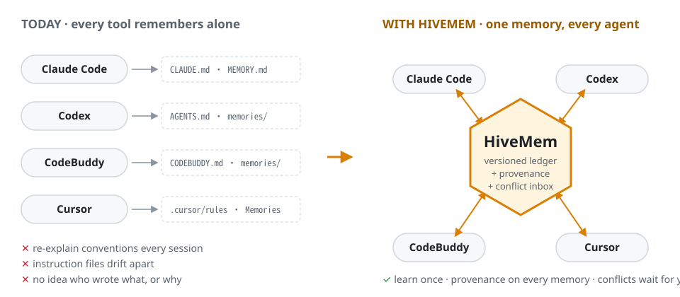
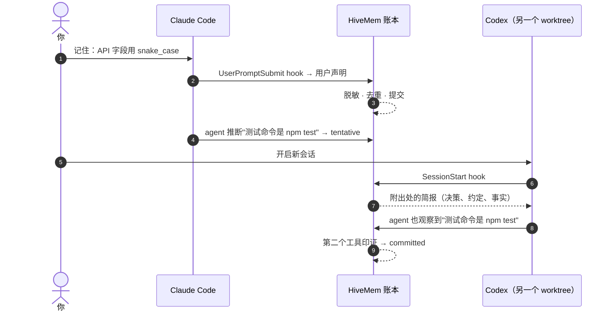
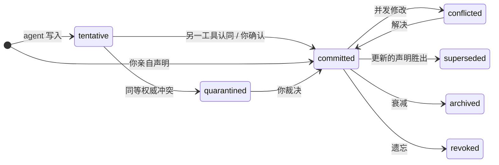
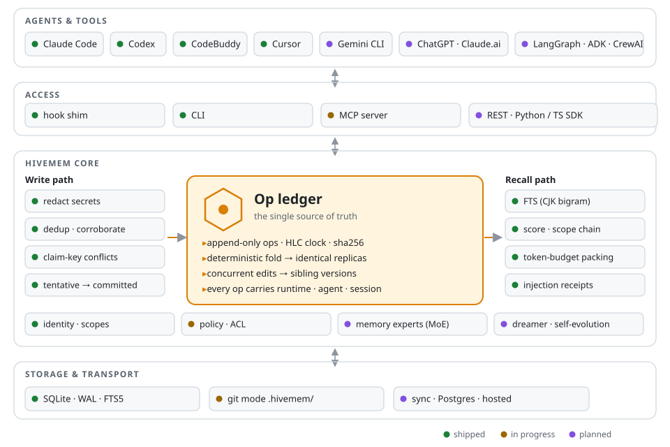

<!-- Translated from README.md; keep in sync. -->
<div align="center">

<picture>
  <source media="(prefers-color-scheme: dark)" srcset="../assets/logo-dark.svg">
  
</picture>

### 一份共享、带版本的记忆，供你用的每一个 agent 使用。

Claude Code · Codex · CodeBuddy · Cursor · Gemini CLI · 多智能体框架

<p>
  
  = 22.18" src="https://img.shields.io/badge/node-%E2%89%A5%2022.18-339933?logo=node.js&logoColor=white">
  
  
  
  
  
</p>

[English](../../README.md) · **简体中文** · [日本語](README.ja.md) · [한국어](README.ko.md)

[快速开始](#-快速开始) · [工作原理](#-工作原理) · [架构](#%EF%B8%8F-架构) · [对比](#%EF%B8%8F-与同类项目对比) · [路线图](#%EF%B8%8F-路线图) · [设计文档](../DESIGN.md)

</div>

<br>

<picture>
  <source media="(prefers-color-scheme: dark)" srcset="../assets/hero-dark.svg">
  
</picture>

你每天在多个 agent 工具之间切换：这个任务用 Claude Code，限流了换 Codex，IDE 里用 CodeBuddy 或 Cursor。**它们的记忆各自独立**，你在一个工具里定下的约定，换到下一个工具就不知道了。HiveMem 让它们**共用一个记忆库**：

- **一处学会，处处可用。** 会话开始时和每次提问时，hook 都会注入相关记忆，agent 不需要"记得去回忆"。
- **每条记忆都有出处。** 记录是哪个工具、哪个 agent、哪个会话、哪个模型写入的，以及依据是什么。
- **分歧不会被悄悄覆盖。** 并发修改会成为并列版本；互相矛盾的说法进入收件箱，由你裁决。
- **核心不调用任何 LLM。** 本地优先，只用一个 SQLite 文件，不增加 token 开销。

> [!NOTE]
> **状态：v0.1 开发中。** 账本核心、本地存储、召回、CLI 和 hook 接入已可用并有测试覆盖（本地在 Windows 上测试，CI 覆盖 macOS 和 Linux）。MCP 服务器、git 模式和原生记忆桥接是接下来的工作（见[路线图](#%EF%B8%8F-路线图)）。欢迎 Star 关注进展；接口仍可能变化。

## 🎬 演示



## 🧭 从哪里开始

| 我想… | 去这里 |
|---|---|
| 60 秒内看到效果 | [快速开始](#-快速开始) |
| 在 Claude Code、Codex 和 CodeBuddy 之间共享记忆 | [接入你的工具](#3-接入你的工具) |
| 了解冲突、可信度和版本如何处理 | [工作原理](#-工作原理) |
| 阅读完整设计 | [DESIGN.md](../DESIGN.md) · [ARCHITECTURE.md](../ARCHITECTURE.md) |
| 了解背后的调研（20+ 个系统、10+ 篇论文） | [research-landscape.md](../research-landscape.md) |
| 参与贡献 | [CONTRIBUTING.md](../../CONTRIBUTING.md) |

## 😩 为什么需要 HiveMem

下面是各 agent 工具 issue 区里讨论最多的记忆问题，以及 HiveMem 的应对：

| 痛点 | 证据 | HiveMem |
|---|---|---|
| 每个工具都有自己的指令文件，互不读取 | [claude-code#6235](https://github.com/anthropics/claude-code/issues/6235)（约 460 条评论）、[codex#17401](https://github.com/openai/codex/issues/17401) | 一个账本；指令文件变成由它生成的视图 *(v0.1，开发中)* |
| 上下文压缩后，上下文和约定丢失 | [claude-code#6354](https://github.com/anthropics/claude-code/issues/6354)、[codex#2927](https://github.com/openai/codex/issues/2927) | 每次提问都重新注入记忆；压缩前抢救将在 v0.1 加入 |
| 自动记忆是黑盒：看不到加载了什么，也改不了错误事实 | [claude-code#82056](https://github.com/anthropics/claude-code/issues/82056)、[codex#30299](https://github.com/openai/codex/issues/30299) | tentative → committed 生命周期、`inbox`、带完整历史的 `show`、注入回执 |
| 并发保存导致记忆丢失或重复 | [codex#26684](https://github.com/openai/codex/issues/26684) | 确定性合并；并发修改成为并列版本，绝不丢失 |
| worktree 和多台机器把同一项目的记忆拆散 | [claude-code#81833](https://github.com/anthropics/claude-code/issues/81833)、[claude-code#81391](https://github.com/anthropics/claude-code/issues/81391) | 项目身份取自规范化的 git remote，所有克隆和 worktree 都是同一个项目 |
| 限流时换工具，一切都要重新解释 | [claude-code#13354](https://github.com/anthropics/claude-code/issues/13354) | 下一个工具的会话一开始就拿到共享简报；交接棒（handoff baton）将在 v0.2 加入 |

## 🚀 快速开始

### 1. 安装

需要 **Node.js ≥ 22.18**。HiveMem 没有运行时依赖，使用 Node 内置的 SQLite，无需编译任何东西。

```bash
git clone <this-repo> hivemem && cd hivemem
npm install          # 仅开发工具（TypeScript）
npm test             # 22 个测试：账本收敛、冲突、召回、hook
```

> [!TIP]
> 发布到 npm 后可直接 `npx hivemem setup`。在此之前，请把下面命令里的 `hivemem` 换成 `node src/cli/main.ts`。

### 2. 60 秒上手

```bash
# 你声明一条约定：立即提交（committed）
hivemem remember "API fields use snake_case; the client converts at the API layer" --as user

# 一个 agent 推断出的事实：在另一个工具认同之前保持 tentative
hivemem remember "Tests run with npm test" --key project:test.command --as agent --runtime claude-code
hivemem remember "Tests run with npm test" --key project:test.command --as agent --runtime codex
# → corroborated … (committed)

# 两个同等权威的 agent 意见不一：两条都进入你的收件箱
hivemem remember "Use pnpm" --key project:pkg.manager --as agent --runtime claude-code
hivemem remember "Use npm"  --key project:pkg.manager --as agent --runtime codex
hivemem inbox

# 在这个仓库里新开会话时会被告知什么（附出处）
hivemem brief
hivemem recall "how should I name fields in the new endpoint?"
```

### 3. 接入你的工具

`hivemem setup` 会打印每个工具的 hook 配置，把它合并进对应文件即可。同一条 `hivemem hook` 命令服务所有工具。

<details>
<summary><b>Claude Code</b>：<code>~/.claude/settings.json</code></summary>

```jsonc
{
  "hooks": {
    "SessionStart":     [{ "hooks": [{ "type": "command", "command": "hivemem hook SessionStart --runtime claude-code" }] }],
    "UserPromptSubmit": [{ "hooks": [{ "type": "command", "command": "hivemem hook UserPromptSubmit --runtime claude-code" }] }]
    // 另有 SubagentStart、Stop、PreCompact、SessionEnd：见 `hivemem setup --target claude-code`
  }
}
```
</details>

<details>
<summary><b>CodeBuddy Code</b>：<code>~/.codebuddy/settings.json</code></summary>

CodeBuddy Code 与 Claude Code 使用相同的 hook 格式。运行 `hivemem setup --target codebuddy` 并合并输出。
</details>

<details>
<summary><b>Codex CLI</b>：<code>~/.codex/hooks.json</code></summary>

Codex 的 hook 格式几乎相同（逐字段对应关系仍在用录制的真实负载核实）。运行 `hivemem setup --target codex`，然后在 `/hooks` 中信任这些 hook。
</details>

<details>
<summary><b>Cursor</b>：<code>.cursor/hooks.json</code></summary>

使用 `--runtime cursor`，HiveMem 会以 Cursor 的 `additional_context` 格式返回。
</details>

<details>
<summary><b>其他工具</b>：MCP <i>(v0.1 推出)</i></summary>

MCP 服务器（stdio 与 Streamable HTTP）将覆盖 Gemini CLI、Copilot、Windsurf、Zed、ChatGPT、Claude.ai 以及各类 agent 框架。
</details>

**直接告诉它。** 在任何已接入的工具里，以 `记住：…`（或 `记一下：…`、`remember that …`、`覚えて：…`、`기억해: …`）开头提问，这条内容就会作为*你本人*的声明保存。

## 🧠 工作原理



**写入 ≠ 采信。** 每条记忆都经过一个小型生命周期，默认只有 *committed* 的记忆会展示给其他 agent：



**矛盾时谁说了算？** 记忆可以带一个*声明键（claim key）*，例如 `project:test.command`。同一个键下出现两个不同答案就是冲突，HiveMem 无需 LLM 即可检测：

| 新声明 vs 已有记忆 | 结果 |
|---|---|
| 你 vs 某个 agent | 你的胜出；旧的变为 **superseded**（保留历史） |
| 你 vs 你自己之前的说法 | 你改主意了，以新的为准 |
| agent vs 你 | agent 的保持 **tentative**，并以 `contradicts` 关联 |
| agent vs agent | 两条都 **quarantined**，在 `hivemem inbox` 等你处理 |

**召回**按相关性、带衰减的重要度、新近度、置信度（被印证会提高）和作用域远近为候选打分，再按 token 预算打包，同一会话内不会重复注入同一条记忆。中文、日文和韩文按字符二元组（bigram）建索引，因此像 `字段` 这样的两字查询，无论句子如何分词都能命中。

## 🏗️ 架构

<picture>
  <source media="(prefers-color-scheme: dark)" srcset="../assets/architecture-dark.svg">
  
</picture>

HiveMem 与众不同的设计选择：

- **记忆是账本，而不是向量库。** 每次变更都是一条不可变操作（op），带混合逻辑时钟（HLC）和内容哈希。数据表、搜索索引以及（即将支持的）指令文件，都是从账本重建出来的投影。
- **真正的一致性模型。** 持有相同 op 的副本无论 op 到达顺序如何，都会算出逐字节相同的状态。并发修改作为并列版本保留，任何写入都不会丢失。属性测试在时钟偏移、随机部分同步的条件下验证了这一点。
- **稳定的项目身份。** 项目 ID 来自规范化的 git remote（依次回退到根提交、路径）。HiveMem 直接读取 `.git/config`，所以每个克隆和 worktree 都是同一个项目，也不需要启动 `git` 子进程。
- **为团队和托管而设计。** 每条 op 都携带租户、主体、运行时、agent 和会话。作用域构成一条链：会话 → agent → 你在该项目 → 项目 → 你。

深入阅读：[ARCHITECTURE.md](../ARCHITECTURE.md) 涵盖数据模型、账本、一致性、写入与召回管线、git 模式、同步、安全以及记忆专家（MoE）。

## ⚖️ 与同类项目对比

|  | **HiveMem** | mem0 | Supermemory | Letta | Mnemon |
|---|:-:|:-:|:-:|:-:|:-:|
| 引擎完全开源 | ✅ | ✅ | ◐ ¹ | ✅ | ✅ |
| 通过 hook 接入多种编程工具 | ✅ | ◐ | ✅ | ◐ ² | ✅ |
| 带版本历史；并发修改绝不丢失 | ✅ | — | ◐ | ◐ ³ | — |
| 每条记忆的出处（工具 · agent · 会话） | ✅ | ◐ | ◐ | ◐ | ◐ |
| 冲突收件箱：agent 之间不能悄悄互相覆盖 | ✅ | — | — | — | — |
| 核心无需任何 LLM | ✅ | — | — | — | ✅ |
| 托管云服务 | 计划中 | ✅ | ✅ | ✅ | — |
| 公开的基准测试结果 | 计划中 | ✅ | ✅ | ✅ | — |

<sub>✅ 支持 · ◐ 部分支持 · — 非其重点。依据截至 2026 年 10 月的公开文档，欢迎指正。¹ 记忆引擎本身不在公开仓库中。² 记忆存在于 Letta 自己的 agent 运行时内。³ 基于 git 的记忆文件（MemFS）。这些项目各有 HiveMem 不具备的长处，也请阅读它们的文档。</sub>

## 🧰 CLI

| 命令 | 作用 |
|---|---|
| `hivemem remember <text>` | 保存一条记忆：`--kind fact\|decision\|event\|procedure`、`--key subject:aspect`、`--as user\|agent`、`--scope project\|user\|agent`、`--tags`、`--importance` |
| `hivemem recall <query>` | 按排名、受预算约束、附出处的上下文（`--json` 包含各项得分） |
| `hivemem brief` | 在这个仓库新开会话时会被注入的内容 |
| `hivemem inbox` | tentative、conflicted 和 quarantined 的记忆 |
| `hivemem show <id>` | 完整历史：版本、op、印证、警告 |
| `hivemem confirm \| forget \| archive <id>` | 推动记忆在生命周期中流转 |
| `hivemem revise <id> <text>` / `resolve <id>` | 修改；或用 `--choose`、`--content` 解决冲突 |
| `hivemem pin \| unpin <id>` | 让某条记忆始终保留在上下文中 |
| `hivemem log` · `stats` · `project` | op 日志、计数、当前项目身份 |
| `hivemem hook <event> --runtime <tool>` | 工具 hook 的入口（从 stdin 读取 JSON；绝不阻塞宿主工具） |
| `hivemem setup [--target …]` | 打印 Claude Code、Codex 和 CodeBuddy 的 hook 配置 |

ID 可以只写最后 6 个字符。数据保存在 `~/.hivemem/`（可用 `HIVEMEM_HOME` 覆盖）。

## 🗺️ 路线图

- **v0.1 跨工具共享** *(开发中)*
  - [x] op 账本：HLC、哈希、确定性折叠、并列版本、收敛测试
  - [x] SQLite 存储；支持中日韩的全文检索
  - [x] 写入路径：脱敏、去重、印证、声明键冲突
  - [x] 召回：打分、作用域链、token 预算、会话内去重
  - [x] CLI 与 hook 接入（Claude Code · Codex · CodeBuddy · Cursor）
  - [ ] MCP 服务器（stdio + Streamable HTTP）
  - [ ] git 模式：`.hivemem/memories/*.md`，PR 评审即记忆评审
  - [ ] 原生记忆桥接：`MEMORY.md`、Codex 与 CodeBuddy 的记忆；`CLAUDE.md` / `AGENTS.md` / `CODEBUDDY.md` 中的托管区块
  - [ ] `setup --apply / --eject`、压缩前抢救、Web 控制台（时间线 · 收件箱 · 注入回执）
  - [ ] 发布到 npm
- **v0.2 多智能体协作**：交接棒、文件/任务认领、变更订阅、子 agent 记忆、基于规则路由的记忆专家、向量嵌入
- **v0.3 团队与办公 agent**：`hivemem serve`（Postgres、OAuth、远程 MCP）、多设备同步、ChatGPT / Claude.ai / Copilot Studio、飞书与 Slack 机器人
- **v0.4 自进化**：后台整合、技能提炼并导出为 `SKILL.md`、学习型路由、"谁懂什么"的专长图谱
- **v0.5 生态**：Python/TS SDK、LangGraph · ADK · Agent Framework · CrewAI 适配器、A2A、开放的多智能体记忆基准

## ❓ 常见问题

<details>
<summary><b>HiveMem 会把我的代码或记忆发到别处吗？</b></summary>

不会。所有数据都存在 `~/.hivemem/` 下的一个 SQLite 文件里。核心不发起任何网络请求，也不调用 LLM。API key、token、私钥、连接串等机密信息在写入前就会被脱敏。
</details>

<details>
<summary><b>它会取代 CLAUDE.md / AGENTS.md 或工具自带的记忆吗？</b></summary>

不会。HiveMem 是桥接而不是取代。计划中的原生桥接会导入各工具的记忆文件，并把托管区块写回去，文件其余部分保持不动。卸载 HiveMem 后，每个工具仍能用自己的文件照常工作。
</details>

<details>
<summary><b>它和规则文件同步工具（ruler、rulesync）有什么区别？</b></summary>

那些工具是在格式之间复制*静态*规则。HiveMem 同步的是*学到的*记忆，每条记忆都有状态、出处、版本和冲突处理，规则文件只是从中渲染出的一种视图。
</details>

<details>
<summary><b>会拖慢我的 agent 吗？</b></summary>

在 Windows 上一次 hook 调用约 116 ms，其中大部分是 Node 自身的启动时间（约 71 ms），HiveMem 本身的工作约 45 ms。计划中的常驻守护进程会进一步缩短这个时间。
</details>

<details>
<summary><b>两个 agent 意见不一时会怎样？</b></summary>

如果其中一条是你说的，以你的为准。如果两条都来自同等权威的 agent，两条都会被隔离（quarantined）并出现在 `hivemem inbox` 中，新会话会收到"有内容待审核"的提示。没有任何内容被删除，每个版本都保留在 `hivemem show` 里。
</details>

## 🤝 参与贡献

欢迎提交 issue 和 PR。适合入手的方向：

- 为更多工具编写 hook 适配器；
- 记忆专家；
- 翻译；
- 基准测试。

请参阅 [CONTRIBUTING.md](../../CONTRIBUTING.md)。设计记录在 [DESIGN.md](../DESIGN.md) 和 [ARCHITECTURE.md](../ARCHITECTURE.md) 中。

## 🙏 致谢

HiveMem 借鉴了以下项目和研究的思路：

- [A-MEM](https://github.com/agiresearch/A-mem)：可演化、相互链接的笔记。
- [Mnemon](https://github.com/mnemon-dev/mnemon)：不依赖 LLM 的核心和广泛的 hook 覆盖。
- [Supermemory](https://github.com/supermemoryai/supermemory)：update/extend/derive 关系。
- [Letta](https://github.com/letta-ai/letta)：基于 git 的记忆。
- [Graphiti](https://github.com/getzep/graphiti)：双时态事实。
- [mem0](https://github.com/mem0ai/mem0)：分作用域的记忆。
- 研究论文：
  - [MemTX](https://www.alphaxiv.org/abs/2607.23929)：写入 ≠ 采信。
  - [Collaborative Memory](https://arxiv.org/abs/2505.18279)：出处与访问控制。
  - [ShardMemo](https://arxiv.org/abs/2601.21545)：带掩码的专家路由。
  - [ACE](https://arxiv.org/abs/2510.04618) 与 [ReasoningBank](https://arxiv.org/abs/2509.25140)：自我进化的流程知识。

## 📄 许可证

[Apache-2.0](../../LICENSE)。如果你在研究中使用了 HiveMem，请引用：

```bibtex
@software{hivemem2026,
  title  = {HiveMem: Shared, Versioned Memory for Multi-Agent and Cross-Tool Collaboration},
  year   = {2026},
  note   = {Version 0.1-dev}
}
```

<div align="center"><sub>为同时使用不止一个 agent 的人而做。🐝</sub></div>
